# 3. Arquitetura e Design Tático DDD

## 3.1 As 4 Camadas Rigorosas da Aplicação

A aplicação adota estritamente a separação em 4 camadas recomendada pelo Domain-Driven Design:

```mermaid
graph TD
    subgraph L1["1. Interface de Usuário / Apresentação (Presentation / API)"]
        C1["AuthController"]
        C2["ContaController"]
        C3["TransacaoController"]
        C4["TransacaoRecorrenteController"]
        C5["CategoriaController"]
        C6["OrcamentoController"]
        C7["DashboardController"]
        DTO["Request / Response DTOs"]
    end

    subgraph L2["2. Aplicação (Application)"]
        S1["AuthServiceImpl"]
        S2["ContaServiceImpl"]
        S3["TransacaoServiceImpl"]
        S4["TransacaoRecorrenteServiceImpl"]
        S5["CategoriaServiceImpl"]
        S6["OrcamentoServiceImpl"]
        S7["DashboardServiceImpl"]
        S8["TransferenciaServiceImpl"]
    end

    subgraph L3["3. Domínio (Domain - O Coração do Software)"]
        AG1["Conta (Aggregate Root)"]
        AG2["Transacao (Aggregate Root)"]
        AG3["TransacaoRecorrente (Aggregate Root)"]
        AG4["Categoria (Aggregate Root)"]
        AG5["Orcamento (Aggregate Root)"]
        VO1["ValorMonetario (Value Object)"]
        VO2["CompetenciaMensal (Value Object)"]
        VO3["DiaVencimento (Value Object)"]
    end

    subgraph L4["4. Infraestrutura (Infrastructure / Persistence)"]
        R1["ContaRepository"]
        R2["TransacaoRepository"]
        R3["TransacaoRecorrenteRepository"]
        R4["CategoriaRepository"]
        R5["OrcamentoRepository"]
        R6["TagRepository"]
        R7["UsuarioRepository"]
        SEC["SecurityFilter / TokenService"]
    end

    L1 --> L2
    L2 --> L3
    L2 --> L4
    L4 -.->|Implementa Portas Spring Data JPA| L3
```



---

## 3.2 Blocos de Construção do Domínio

### 1. Value Objects Imutáveis (`br.com.gerenciadorfinanceiro.model.vo`)
* **`ValorMonetario`:** Encapsula validação estrita de valores positivos, arredondamento padrão bancário (`RoundingMode.HALF_UP` com 2 casas) e o algoritmo de rateio sem perda de centavos (`parcelar(int parcelas)`). O centavo residual é sistematicamente alocado na 1ª parcela.
* **`CompetenciaMensal`:** Valida o mês entre `1` e `12` e o ano entre `2000` e `2100`, provendo representações formatadas (ex: `10/2026`).
* **`DiaVencimento`:** Valida e restringe o dia do mês entre `1` e `31`, assegurando compatibilidade com meses mais curtos através de ajuste dinâmico de calendário (`Math.min(diaVencimento, data.lengthOfMonth())`).

### 2. Encapsulamento de Agregados e Comandos Ricos
Todas as entidades do domínio tiveram o `@Setter` irrestrito de classe removido. As mutações de estado ocorrem exclusivamente por métodos intencionais:
* **`Conta`:**
  * `debitar(BigDecimal valor)`: valida saldo suficiente para saques e deduz o valor.
  * `creditar(BigDecimal valor)`: soma o valor ao saldo existente.
  * `atualizarDadosCadastrais(String nome, String instituicao, TipoConta tipo)`: modifica metadados sem interferir no saldo financeiro.
* **`Transacao`:**
  * `liquidar()`: transiciona o status para `PAGA`.
  * `estornarParaPendente()`: transiciona para `PENDENTE`.
  * `retificar(...)`: atualiza dados operacionais e valor com consistência monetária.
  * `sincronizarComRecorrencia(TransacaoRecorrente rec)`: atualiza metadados e valor pendente a partir do plano pai.
* **`TransacaoRecorrente`:**
  * `atualizarPlano(...)`: ajusta a regra temporal e valores para as futuras ocorrências.
  * `alternarAtivacao()`: suspende ou reativa a geração automática de transações.
* **`Orcamento`:**
  * `atualizarLimite(BigDecimal novoLimite, String novaObservacao)`: redefine o teto da competência.
  * `ultrapassouLimite(BigDecimal totalGasto)`: calcula se a quantia gasta extrapolou o teto previsto.

---

## 3.3 Concorrência Otimista (*Optimistic Locking*) e Desativação do OSIV

### Concorrência Otimista
Para mitigar o risco de *Lost Update* em transações concorrentes sobre a mesma conta bancária, a entidade `Conta` conta com controle de versão:
```java
@Version
@Column(nullable = false, columnDefinition = "bigint default 0")
private Long version = 0L;
```
Quando duas transações tentam alterar a mesma conta simultaneamente, a segunda falha com `ObjectOptimisticLockingFailureException`, tratada pelo `GlobalExceptionHandler` retornando HTTP 409 Conflict.

### Desativação do OSIV (*Open Session in View*)
Configurado em `application.yml`:
```yaml
spring:
  jpa:
    open-in-view: false
```
Isso assegura que nenhuma conexão JDBC permaneça aberta após o término da execução do método `@Transactional` na camada de serviço, prevenindo chamadas lentas e consultas N+1 acidentais durante a serialização dos DTOs na camada de apresentação.
