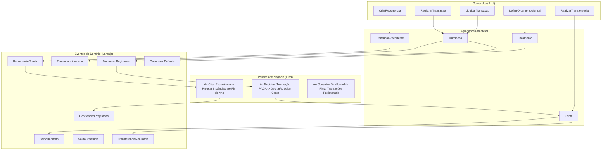

# 4. Domain Storytelling e Event Storming

## 4.1 Domain Storytelling (Narrativas Sequenciais de Domínio)

### Cenário 1: Aquisição Parcelada de Bem Durável
1. **Ator:** Usuário (Lucas).
2. **Objeto:** `TransacaoRequestDto` com `valor: 100,00`, `tipo: DESPESA`, `parcelas: 3`.
3. **Atividade:** O Usuário envia o comando de parcelamento via API.
4. **Aplicação:** `TransacaoService` invoca `ValorMonetario.ofPositivo(valor).parcelar(3)`.
5. **Domínio:** O Value Object rateia o montante gerando 3 parcelas exatas: `R$ 33,34` (com o centavo residual), `R$ 33,33` e `R$ 33,33`.
6. **Agregado:** A 1ª parcela é criada como `StatusTransacao.PAGA` e debita da `Conta`; as parcelas 2 e 3 são geradas com `StatusTransacao.PENDENTE` para os meses subsequentes.
7. **Resultado:** O saldo da conta é debitado em exatamente `R$ 33,34`, mantendo o histórico de lançamentos futuros agendados.

### Cenário 2: Transferência Patrimonial entre Contas
1. **Ator:** Usuário (Lucas).
2. **Objeto:** `TransferenciaRequestDto` (`origemId: 1`, `destinoId: 2`, `valor: 500,00`).
3. **Aplicação:** `TransferenciaService` orquestra a operação dentro de uma única transação atômica (`@Transactional`).
4. **Domínio:**
   - `contaOrigem.debitar(500,00)`: valida saldo e deduz.
   - `contaDestino.creditar(500,00)`: adiciona ao saldo do destino.
   - Gera `Transacao.criarSaidaTransferencia(...)` com `transferencia = true` sob a categoria "Transferência entre Contas".
   - Gera `Transacao.criarEntradaTransferencia(...)` com `transferencia = true` sob a categoria "Transferência entre Contas".
5. **Resultado:** Ambas as contas exibem a movimentação no endpoint `GET /contas/{id}/extrato`, mas o Dashboard ignora os dois lançamentos no cálculo de despesas e receitas operacionais do mês.

---

## 4.2 Event Storming (Big Picture)

### Eventos Pivotais do Sistema
1. **`ContaRegistrada`:** Cria a conta patrimonial com saldo inicial imutável.
2. **`TransferenciaRealizada`:** Movimenta patrimônio entre duas contas e gera extrato espelhado.
3. **`TransacaoLiquidada`:** Efetiva um pagamento pendente e abate o saldo bancário correspondente.
4. **`OcorrenciasRecorrenciaProjetadas`:** Projeta instâncias de contas fixas vinculadas por `recorrencia_id`.
5. **`OrcamentoDefinido`:** Estabelece o teto orçamentário mensal para uma categoria de despesa.

### Hotspots Resolvidos
* **Hotspot 1 (Resolvido):** Perda de centavos em divisões parceladas. Resolvido via `ValorMonetario.parcelar()`.
* **Hotspot 2 (Resolvido):** Ambiguidade e perda de sincronia em recorrências quando o nome da transação era alterado. Resolvido com vínculo estrito por chave estrangeira `recorrencia_id`.
* **Hotspot 3 (Resolvido):** Transferências inflando receitas e despesas operacionais no Dashboard. Resolvido com a coluna booleana `transferencia` e filtros explícitos no Read Model.
* **Hotspot 4 (Resolvido):** Sobrecarga de memória no Dashboard ao buscar todas as transações do banco. Resolvido com consultas agregadas em banco via JPQL/SQL.
