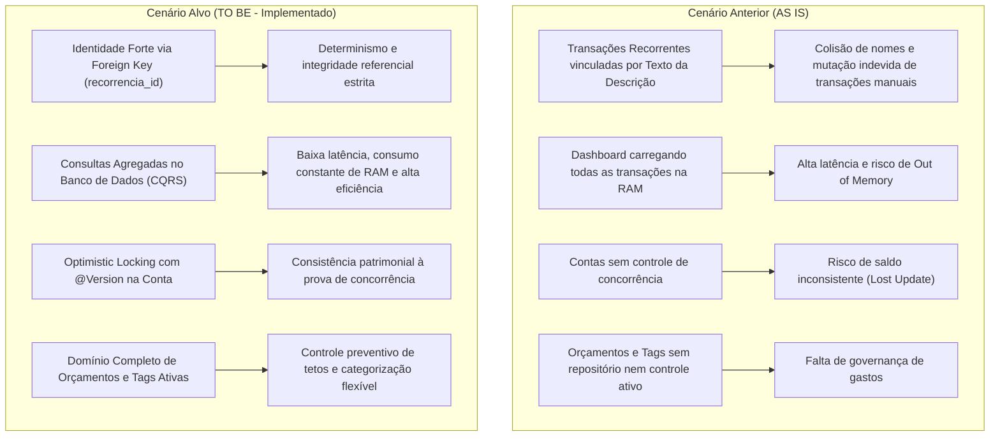

# 1. Visão Geral, Diagnóstico de Riscos e Anatomia da Solução

## 1.1 Visão do Produto
O **Gerenciador Financeiro** é uma plataforma de gestão financeira pessoal e familiar construída para proporcionar visibilidade em tempo real sobre receitas, despesas, transferências patrimoniais, limites orçamentários por categoria e compromissos recorrentes. A plataforma elimina inconsistências de saldo, duplicidade de despesas e assimetria de informações por meio de modelagem orientada a domínio (DDD).

### Persona Principal
* **Nome:** Lucas Silva, 34 anos.
* **Perfil:** Profissional CLT com renda fixa principal, trabalhos autônomos (freelances pontuais) e investimentos diversificados (CDI, Fundos Imobiliários e Ações). Possui contas bancárias ativas em múltiplos bancos (Nubank, Itaú) e utiliza cartões de crédito e despesas parceladas.
* **Dores:** Dificuldade em prever o saldo real no final do mês devido a parcelas futuras de compras, risco de ultrapassar tetos orçamentários sem alertas, retrabalho ao cadastrar despesas fixas recorrentes todo mês e confusão entre transferências de investimento e despesas operacionais reais.

---

## 1.2 Matriz dos 4 Grandes Riscos (Marty Cagan)

| Dimensão de Risco | Pergunta Crítica | Diagnóstico no Gerenciador Financeiro | Mitigação Implementada |
| :--- | :--- | :--- | :--- |
| **1. Risco de Valor (*Value Risk*)** | O usuário realmente extrai valor e utiliza o sistema no dia a dia? | Se o Dashboard exibir números inflados ou duplicados devido a transferências internas entre contas, o usuário perde a confiança no balanço real. | Transferências registradas com flag `transferencia = true` e desconsideradas no cálculo de despesas/receitas operacionais do Dashboard. |
| **2. Risco de Usabilidade (*Usability Risk*)** | O usuário consegue entender e utilizar as regras sem atrito ou confusão? | Inversões visuais em ícones/descrições de categorias ou falha ao ratear centavos em parcelamentos geram frustração imediata. | Correção das propriedades de categoria e criação do Value Object `ValorMonetario`, alocando centavos residuais na 1ª parcela de compras parceladas. |
| **3. Risco de Viabilidade Técnica (*Feasibility Risk*)** | A arquitetura suporta escalabilidade, concorrência e integridade de dados? | Carregamento completo de transações em memória para cálculo do Dashboard gerava risco de estouro de memória (OOM); ausência de concorrência gerava risco de *Lost Update*. | Implementação de consultas SQL/JPQL agregadas no banco de dados (CQRS Read Model), desativação do OSIV e `@Version` na entidade `Conta`. |
| **4. Risco de Negócio / Financeiro (*Business Viability Risk*)** | O sistema protege contra rombos orçamentários e regras de conformidade? | Gastos excessivos em categorias essenciais sem monitoramento de tetos levavam a endividamento. | Ativação do agregado `Orcamento`, impedindo limites para categorias de receita e apurando percentual de consumo em tempo real. |

---

## 1.3 Anatomia da Solução: AS IS vs. TO BE

---

## 1.4 Requisitos Funcionais (RF) e Não-Funcionais (RNF)

### Requisitos Funcionais
* **RF-01 (Gestão de Contas):** Cadastro, consulta de saldos consolidados e controle transacional de contas correntes, poupanças e investimentos.
* **RF-02 (Transferências Auditáveis):** Lançamento de transferências patrimoniais entre contas com registro espelhado de saída e entrada no extrato.
* **RF-03 (Lançamentos Parcelados sem Perda de Centavos):** Divisão exata de compras a prazo garantindo que a soma das parcelas seja rigorosamente igual ao valor da compra.
* **RF-04 (Recorrências Determinísticas):** Projeção periódica de contas a pagar/receber com liquidação retroativa e sincronização com base no identificador da recorrência.
* **RF-05 (Tetos Orçamentários):** Definição de limites mensais por categoria de despesa e apuração do consumo percentual e valor gasto.
* **RF-06 (Dashboard em Tempo Real):** Indicadores de saldo geral, receitas pagas, despesas pagas, transações recentes e evolução semântica de 6 meses.

### Requisitos Não-Funcionais
* **RNF-01 (Isolamento em 4 Camadas):** Zero vazamento de frameworks externos ou acesso a banco nas entidades de domínio e controllers.
* **RNF-02 (Concorrência Otimista):** Detecção de colisões de escrita em contas bancárias retornando HTTP 409 Conflict.
* **RNF-03 (Desativação do OSIV):** `spring.jpa.open-in-view: false`, garantindo que sessões de persistência não permaneçam abertas na camada de apresentação.
* **RNF-04 (Performance CQRS):** Agregações de somas e agrupamentos executadas pelo mecanismo de consulta do banco de dados relacional.
